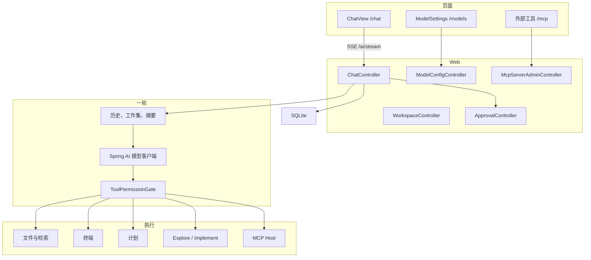
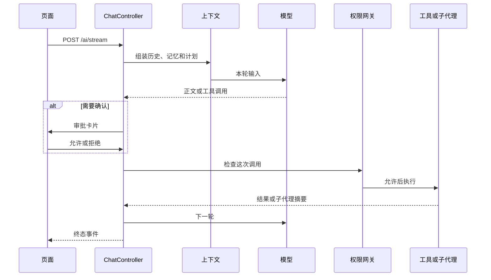

# 架构

BearCoding 是本地单用户编码智能体。页面负责展示和确认，后端的 Agent 循环决定何时调用工具。数据在 SQLite。没有独立的账号服务。

Spring AI 提供 OpenAI 兼容的模型调用。循环编排、计划、子代理房间、上下文投影和权限网关是本仓库自己的代码。

## 分层

`ChatController` 同时持有循环、压缩、审批等待和工具回调。它是编排入口，不是一层转发。

## Agent 循环

`POST /ai/stream` 返回 `SseEmitter`。循环在专用线程里跑，避免堵住 servlet 线程。入口是 `ChatController` 的流式方法，每一轮调用前的整理在 `guardRound`。

每一轮大致是：

1. 组装消息：系统提示（`AgentPrompts`）、当前工作区记忆、已有的用户记忆、活动计划、历史和本轮用户输入。
2. 估算超过预算时压缩或投影。见 [上下文](CONTEXT-MANAGEMENT.md)。
3. 调用模型。模型可以只返回正文，也可以返回工具调用。
4. 每个工具调用进入 `ToolDispatcher`，再进入 `ToolPermissionGate`。允许则执行；需要确认则停下，等审批接口。
5. 工具结果追加为消息，进入下一轮。
6. 模型不再要工具，或迭代、窗口、任务输入预算到达上限，则结束，并推送终态事件。

页面可以发停止。停止后循环不再为了补一段总结去请求模型。同一会话不会把两路 SSE 混在一起。

控制器里仍有 `POST /ai/chat`，返回整段 JSON。聊天页不使用它。

计划和子代理不是每轮必经。没有计划时，主循环可以提醒模型去建一份；模型不调用 `spawnSubagent` 时，不会开子线程，也不会多一次模型请求。

## 一次编程任务

## 计划

计划工具是 `createPlan` 和 `updatePlanStep`。默认入参是按行拆开的纯文本（`app.plan.steps.mode=flat`）。`structured` 仍保留，用来对照。

默认注入是精简的：平时一行摘要，步骤变化、隔若干轮或刚压缩过，才注入完整清单（`app.plan.injection.slim=true`）。

还没有计划时，后端可以提醒模型去建计划。默认是 `soft`：只提醒，不强制。`hard` 会在下一轮拿掉写工具。Spring AI 1.0.0 的 OpenAI 客户端不会把 `toolChoice` 放进请求，所以不能靠那条路强制创建计划。

计划存在会话里，和对话一起持久化。它不单独占用一条执行预算。执行仍算在主循环上。

## 工具注册与回灌

内置工具由 Spring 的 `@Tool` 方法注册，`ChatController` 在每轮把回调交给模型。分发在 `ToolDispatcher`：找不到工具就返回错误文本，不把这一轮打崩；找到了就先过网关，再执行。

结果写回对话，也写入工具审计。写文件类工具会把「文件已改」标出来，父循环可以接着做 Java 编译校验。校验只覆盖 `javac`，不覆盖其他语言。

## Explore 与 Implement

主代理调用 `spawnSubagent` 时，`SubagentService` 另开一个房间。`SubagentRunner` 用更短的系统提示和一份工具白名单。Explore 只有读和搜索；Implement 可以写和执行命令，同时只允许一个。房间跑完只把摘要交回主循环，不把房间里的工具原文塞回去。

默认开启（`app.subagent.enabled=true`）。档位是 quick 24 轮、medium 48 轮、thorough 72 轮，硬顶 96 轮。超出并发上限（默认 4）直接拒绝，不排队。

PARTIAL 表示轮数用尽但还有结论。主代理看到未覆盖的部分后，可以自己补做，也可以带上结果里的 `resumeTaskId` 再派一次。续跑沿用原房间的模式和保留的历史，同一目标的续跑次数由 `max-resumes-per-goal` 限制（默认 1）。凭据不属于本会话或已经过期时，续跑失败，不会降级成一个新的 Explore 房间。

内核不会在 PARTIAL 之后自己再请求模型。是否继续，由主代理决定。

子代理默认拿不到 MCP 工具，也拿不到用户记忆的写入工具。约束要写在派发时的目标里。

## SSE

`produces = text/event-stream`。事件体是 JSON，由 `SseEmitter.event().name(...)` 发出。页面据此区分正文增量、工具开始与结束、计划、审批和终态。开发服务器代理显式关闭压缩，否则浏览器侧会把流缓冲成一整段。

事件名以 `ChatController` 里实际发出的为准，这里不逐个罗列。

## 记忆、上下文和权限怎样进主流程

上下文整理发生在每次模型调用之前，见 [上下文](CONTEXT-MANAGEMENT.md)。工作区记忆在系统提示之后注入，只覆盖当前工作区。用户记忆是另一条系统消息，按当前会话的用户读取；写入和删除要先审批。

权限在工具执行前，不在模型生成文本时。网关拒绝的调用不会执行，模型只看到拒绝说明。细节见 [MCP 与安全](MCP-AND-SECURITY.md)。

## 主要类

| 类 | 职责 |
|---|---|
| `ChatController` | SSE 循环、压缩时机、工具回灌、停止 |
| `AgentPrompts` | 主提示和子房间提示 |
| `ToolDispatcher` | 按名字找到工具并调用 |
| `ToolPermissionGate` | ALLOW / ASK，以及批准后的复查 |
| `PermissionPolicy` | 内置工具的默认规则 |
| `SubagentService` / `SubagentRunner` | 派出、白名单、轮数、续跑凭据 |
| `ContextCompactor` | 历史摘要 |
| `ContextProjectionPolicy` | 有界工作集 |
| `ContextAssetTool` | `searchContext` |
| `McpClientManager` | stdio / HTTP 连接与工具目录 |
| `PathSandbox` | 工作区路径检查 |

## 取舍和局限

- 循环放在一个控制器里，而不是再拆一套工作流引擎。行为集中，类也因此偏大。
- 计划是提醒和注入，不是强制的状态机。模型仍可能不建计划。
- 子代理回来只交摘要。细节会丢，主代理要核对时得再读指定位置。
- 续跑有次数上限。用完后主代理只能自己做，或换一个更窄的目标。
- 路径检查和审批是应用内规则，不是容器或操作系统隔离。
- 自动编译校验只支持 Java。

离线测试覆盖循环辅助逻辑、子代理、压缩、工作集、检索、权限和 MCP 管理。真实模型上的一次完整任务（读文件、改文件、编译运行）和本机 MCP 已经验收；真实外部 MCP 服务仍未验收。
